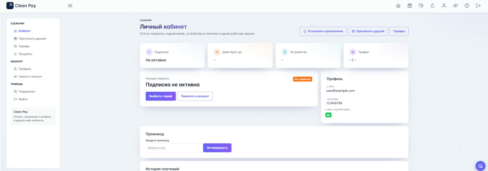
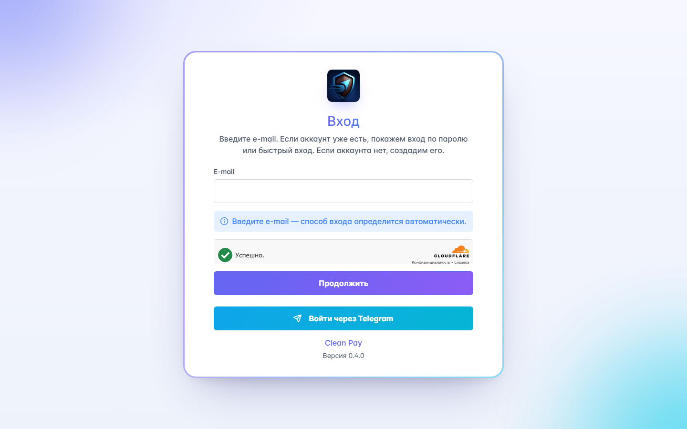
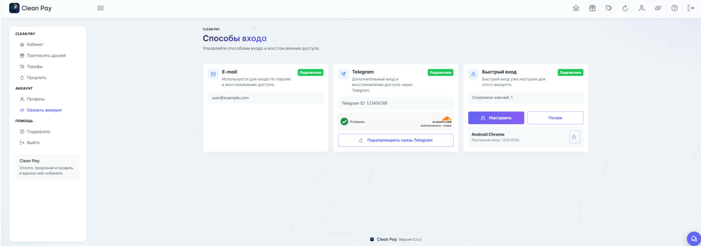

# Clean Pay

Clean Pay — веб-кабинет для оплаты и управления подписками
Remnashop/Remnawave. Пользователь может войти по e-mail, Telegram или Passkey,
купить и продлить подписку, управлять устройствами и посмотреть историю
платежей. Авторизованным пользователям также доступен чат поддержки, если
владелец сервиса включил интеграцию Chatwoot.

> **Требования к панели:** Remnawave **2.8.0** или новее и ноды **remnanode
> 2.8.0** или новее. На более старых версиях Clean Pay и Remnashop не
> поддерживаются. Версию панели показывает и обновляет меню (`./menu.sh` →
> «Обновить Remnawave»); ноды обновляются на своих серверах.

Production-запуск использует Docker Compose, собственные PostgreSQL и Redis.
Установщик проверяет окружение и Remnashop, применяет миграции отдельным
одноразовым контейнером и только после этого запускает приложение и workers.

## Интерфейс

<p align="center">
  <a href="docs/screenshots/dashboard.png">
    
  </a>
</p>
<p align="center">
  <sub>Личный кабинет: подписка, устройства, трафик и платежи.</sub>
</p>

<table>
  <tr>
    <td width="50%" valign="top">
      <a href="docs/screenshots/login.png">
        
      </a>
    </td>
    <td width="50%" valign="top">
      <a href="docs/screenshots/authentication-methods.png">
        
      </a>
    </td>
  </tr>
  <tr>
    <td align="center"><sub>Вход по e-mail или через Telegram.</sub></td>
    <td align="center"><sub>E-mail, Telegram и быстрый вход.</sub></td>
  </tr>
</table>

## Меню управления

Всё обслуживание сервера собрано в одном интерактивном меню. Оно ведёт по
установке, обновлению и резервному копированию Clean Pay и Remnashop, следит
за версией Remnawave и обновляет её, и запоминать команды не нужно:

```bash
./menu.sh
```

```text
━━━━━━━━━━━━━━━━━━━━━━━━━━━━━━━━━━━━━━━━━━━━━━━━━━━━━━━━━━━━━━━━━━
  CLEAN PAY · центр управления
━━━━━━━━━━━━━━━━━━━━━━━━━━━━━━━━━━━━━━━━━━━━━━━━━━━━━━━━━━━━━━━━━━
  Clean Pay   ● работает   версия a1b2c3d
  Remnashop   ● работает   версия d4e5f6a
  Remnawave   ● работает   2.8.0
  Сервер      12,4 ГБ свободно · последняя копия: 5 мин назад

  СОСТОЯНИЕ
    1  Подробное состояние и здоровье
    2  Проверка сервера перед установкой
    3  Логи сервисов

  CLEAN PAY
    4  Установить Clean Pay (мастер первой установки)    [копия]
    5  Обновить Clean Pay до новой версии                [копия]
    6  Изменить настройки (.env)
    7  Применить настройки (перезапуск)
    8  Остановить Clean Pay

  REMNASHOP
    9  Обновить Remnashop                                [копия]
   10  Установить Remnashop с нуля                       [копия]
   11  Связать с Clean Pay: права .env, общий ключ, проверка

  REMNAWAVE (панель ≥ 2.8.0, ноды ≥ 2.8.0)
   12  Обновить Remnawave                                [копия]

  РЕЗЕРВНЫЕ КОПИИ
   13  Создать полную резервную копию сейчас
   14  Список копий и проверка
   15  Как восстановить из копии

  СПРАВКА
   16  Обновление без простоя (zero-downtime)
   17  Настройки меню

    0  Выход
```

Меню не заменяет установщик, а управляет им: Clean Pay ставится и обновляется
теми же проверенными командами `./deploy.sh`, которые описаны ниже. Пункты с
пометкой **[копия]** — глобальные действия. Перед ними меню само делает полную
резервную копию и проверяет её. Если копию создать не удалось, действие
отменяется, а система остаётся без изменений.

При запуске по SSH меню предлагает открыться внутри `screen`: если соединение
оборвётся посреди обновления, операция продолжится, а вернуться к ней можно
командой `screen -r clean-pay-menu`.

### Что делает каждый пункт

| Пункт | Что происходит |
| --- | --- |
| Состояние | контейнеры Clean Pay, Remnashop и Remnawave, версии, readiness, схема БД Remnashop, версия панели против требуемой 2.8.0, свободное место, последняя копия |
| Проверка сервера | Docker, Compose, свободное место, `vm.overcommit_memory`, права `.env`, совместимость Remnashop, версия Remnawave ≥ 2.8.0; ничего не меняет |
| Установить Clean Pay | копия существующих данных → настройки `./deploy.sh configure` → права `.env` Remnashop и общий ключ (см. «Связать с Clean Pay») → вопрос о DNS и HTTPS → `./deploy.sh install` |
| Обновить Clean Pay | выбор тега, ветки или SHA → список изменений и новых миграций → копия → права `.env` Remnashop и общий ключ → `./deploy.sh build`, пока сайт работает → подтверждение словом `ОБНОВИТЬ` → `./deploy.sh install` |
| Изменить / применить настройки | `./deploy.sh configure` и безопасный `./deploy.sh restart` |
| Остановить | `./deploy.sh down` после ввода слова `ОСТАНОВИТЬ`; данные и тома сохраняются |
| Обновить Remnashop | сборка образа из исходников, пока бот работает → проверка новых миграций Alembic → копия → миграции (если есть) → новый образ и проверки здоровья (healthcheck) этой версии в compose, остальной compose не меняется → перезапуск API, worker и scheduler → проверка совместимости с Clean Pay. Установка по compose апстрима snoups (образ `ghcr.io/snoups/remnashop`, нет сервиса `remnashop-migration`) переводится на сборку Clean Pay: compose из выбранной версии, к `.env` добавляются недостающие ключи (прежние значения не меняются), база и Redis остаются в своих томах; новые файлы проверяются, пока старый стек работает, и при сбое до миграций всё возвращается как было |
| Связать с Clean Pay | ставит права каталога Remnashop 750 и `.env` 600 (иначе Clean Pay его не примет), переносит `REMNASHOP_AUTH_SERVICE_KEY` Clean Pay в `APP_AUTH_SERVICE_KEY` Remnashop и после подтверждения перезапускает API, worker и scheduler (~30 с), затем запускает проверку совместимости. Значения ключей на экран не выводятся. То же из командной строки: `./menu.sh remnashop-link` |
| Установить Remnashop | исходники, образ, `docker-compose.yml`, `.env` с сгенерированными секретами и вопросами о токенах, база, миграции, запуск. Предлагаются только ветки: теги `v0.x` в форке — релизы апстрима без интеграции с Clean Pay, и такие версии меню отклоняет до сборки |
| Обновить Remnawave | только если панель на этом сервере: `docker pull` образа по тегу из её compose, пока панель работает → новая версия должна быть ≥ 2.8.0, той же мажорной версии и не старее текущей → копия (в том числе база панели) → подтверждение словом `ОБНОВИТЬ` → пересоздание одного сервиса backend → ожидание healthy; если не поднялась — возврат прежнего образа. Тег, закреплённый на конкретной версии, меню не меняет |
| Резервные копии | создание, список, проверка контрольных сумм и читаемости дампов, готовые команды восстановления |

### Обновление и откат

При обновлении Clean Pay меню записывает в `deploy/prod/.env` только пять
релизных полей: образы приложения и миграций с SHA в имени, релиз и ревизию.
Благодаря SHA в имени прежние образы остаются на диске, и откат не требует
пересборки.

- Сборка не удалась или подтверждение не получено — код и релизные поля
  возвращаются автоматически, работающая версия не затрагивается.
- `install` не удался, а новых миграций не было — меню предлагает вернуть
  предыдущую версию и запустить её.
- В новой версии есть миграции — автоматический откат кода запрещён: старый код
  поверх изменённой схемы опасен. Используйте резервную копию и пункт «Как
  восстановить из копии».

При обновлении Remnashop прежний образ тоже сохраняется. Если новые контейнеры
не стали healthy, а миграций не было, меню само возвращает прежний образ. Если
миграция упала, API, worker и scheduler остаются остановленными до решения
оператора.

### Резервные копии

Полная копия включает:

- дампы PostgreSQL Clean Pay и Remnashop (`pg_dump --format=custom`) и роли
  PostgreSQL Clean Pay;
- дамп базы Remnawave, её `.env` и `docker-compose.yml`, если панель
  работает на этом же сервере;
- `deploy/prod/.env` и все сгенерированные из него файлы ролей;
- `.env` и `docker-compose.yml` Remnashop;
- Caddyfile reverse proxy (находится автоматически по контейнеру Caddy);
- `manifest.txt` с commit, образами, релизом, ревизией Alembic и версией
  Remnawave;
- `SHA256SUMS` для проверки целостности.

Каждый дамп сразу проверяется чтением через `pg_restore --list`. По умолчанию
копии лежат в `/var/backups/clean-pay` с правами `0700`, а все действия
записываются в `journal.log` там же. В копиях есть секреты, поэтому храните их
только у root и регулярно выносите за пределы сервера. Меню старые копии не
удаляет: удаляйте их вручную, когда уверены, что они больше не нужны.

Восстановление перезаписывает рабочие данные, поэтому меню его не выполняет, а
показывает точные команды для выбранной проверенной копии.

Без меню те же операции доступны командами — например, для ежедневной копии
через cron:

```bash
./menu.sh status
./menu.sh backup nightly
./menu.sh verify КАТАЛОГ_КОПИИ
./menu.sh help
```

```cron
15 3 * * * /путь/к/clean-pay/menu.sh backup nightly >> /var/log/clean-pay-backup.log 2>&1
```

### Настройки меню

Пункт «Настройки меню» сохраняет значения в `deploy/prod/menu.env`. Этот файл
не отслеживается git, и секретов в нём нет:

| Параметр | Назначение |
| --- | --- |
| `BACKUP_DIR` | каталог резервных копий |
| `REMNASHOP_DIR` | каталог Remnashop с `docker-compose.yml` и `.env`; по умолчанию берётся из `REMNASHOP_ENV_FILE` |
| `REMNASHOP_REPO` | git-репозиторий исходников Remnashop |
| `REMNASHOP_SOURCES` | локальное bare-зеркало исходников |
| `REMNASHOP_STAGING` | каталог исходников и журналов сборки |
| `REMNASHOP_IMAGE`, `REMNASHOP_TAG_PREFIX` | имя образа Remnashop; тег — префикс плюс полный SHA |
| `CADDYFILE` | путь к Caddyfile, если автоопределение не подходит |
| `REMNAWAVE_CONTAINER`, `REMNAWAVE_DB_CONTAINER` | контейнеры панели Remnawave и её PostgreSQL; по умолчанию `remnawave` и `remnawave-db` |

## Установка: один мастер, три этапа

### 1. Подготовьте сервер и интеграции

Нужны:

- Linux-сервер с Docker Engine, Docker Compose v2, `git`, `curl` и `openssl`;
- не менее 8 ГиБ свободного места и `vm.overcommit_memory=1` на хосте Docker;
- Remnashop на том же Docker daemon (ветка `main` форка
  [flake92/remnashop](https://github.com/flake92/remnashop), не теги `v0.x`);
- Remnawave **2.8.0** или новее и ноды **remnanode 2.8.0** или новее;
- домен Clean Pay, DNS и HTTPS reverse proxy;
- токены Remnashop, Remnawave и Telegram, а также ключи Cloudflare Turnstile.

Node.js на сервере необязателен: при его отсутствии установщик использует
изолированный tooling-контейнер. Если Node.js уже установлен, его версия должна
совпадать с [`.node-version`](.node-version).

Для новой установки сначала обновите Remnashop минимум до Alembic revision
`0059` (пункт меню «Обновить Remnashop», версия `main`; если Remnashop ещё нет —
«Установить Remnashop с нуля»). Remnashop, поставленный по инструкции апстрима
snoups, меню переведёт на сборку Clean Pay тем же пунктом; теги `v0.x` — это
релизы апстрима без интеграции, меню их отклоняет. Проверено на сервере с
1 vCPU и 2 ГБ памяти. Его API, worker и scheduler должны работать из одного image. Clean Pay
не запускает миграции чужого проекта — он только проверяет image, схему и
API-контракт перед собственным запуском.

Пример минимального Caddyfile:

```caddyfile
pay.example.com {
    reverse_proxy 127.0.0.1:4000
}
```

То же для nginx:

```nginx
server {
    listen 443 ssl;
    http2 on;
    server_name pay.example.com;
    ssl_certificate     /etc/letsencrypt/live/pay.example.com/fullchain.pem;
    ssl_certificate_key /etc/letsencrypt/live/pay.example.com/privkey.pem;

    location / {
        proxy_pass http://127.0.0.1:4000;
        proxy_http_version 1.1;
        proxy_set_header Host $host;
        proxy_set_header X-Real-IP $remote_addr;
        proxy_set_header X-Forwarded-For $proxy_add_x_forwarded_for;
        proxy_set_header X-Forwarded-Proto https;
    }
}
```

Если nginx работает в Docker-контейнере (например, `remnawave-nginx`),
адрес loopback внутри него — это сам контейнер; тогда укажите
`proxy_pass http://clean-pay:4000;` — под этим именем приложение подключено к
сети `CLEAN_PAY_EDGE_NETWORK` (по умолчанию `remnawave-network`). Сертификат
нужен на сам домен Clean Pay; при домене за Cloudflare без него Cloudflare
отвечает `525`.

Панель, поставленная скриптом eGames, скрыта за секретной cookie, и без неё её
nginx на запросы API отвечает `404`. Укажите ту же cookie в `REMNAWAVE_COOKIE`
(мастер настройки спрашивает её после токена Remnawave) — иначе установка
остановится на «dependencies are not ready: remnawave».

До запуска Clean Pay reverse proxy может временно отвечать `502`; сертификат,
маршрут и внешний HTTPS должны быть готовы до подтверждения соответствующего
вопроса мастера.

### 2. Получите проверенную версию

Production запускается из зафиксированного тега, а не из меняющейся вершины
ветки.

```bash
RELEASE_REF='refs/tags/v0.3.5'
sudo mkdir -p /opt/clean-pay
sudo chown "$USER":"$USER" /opt/clean-pay
git clone https://github.com/flake92/clean-pay.git /opt/clean-pay
cd /opt/clean-pay
git fetch --depth=1 origin "$RELEASE_REF"
RELEASE_SHA=$(git rev-parse FETCH_HEAD)
test -n "$RELEASE_SHA"
git checkout --detach "$RELEASE_SHA"
test "$(git rev-parse HEAD)" = "$RELEASE_SHA"
test -z "$(git status --porcelain --untracked-files=all)"
printf 'Deploying commit %s\n' "$RELEASE_SHA"
```

Сохраните выведенный SHA в журнале выпуска.

### 3. Запустите мастер

```bash
./deploy.sh setup
```

Тот же мастер запускается из меню: `./menu.sh` → «Установить Clean Pay». В этом
случае меню сначала проверит сервер и сохранит копию уже существующих данных
Remnashop.

Мастер проводит через три внутренних этапа:

1. создаёт защищённый `deploy/prod/.env`, спрашивает обязательные адреса и
   токены и генерирует внутренние секреты;
2. проверяет готовый `deploy/prod/docker-compose.yml` и Docker-сеть;
3. собирает и проверяет образы, применяет миграции и запускает сервисы.

Писать YAML вручную не требуется. Clean Pay и Remnashop связаны общим ключом:
`REMNASHOP_AUTH_SERVICE_KEY` из `deploy/prod/.env` должен совпадать с
`APP_AUTH_SERVICE_KEY` в `.env` Remnashop, иначе Remnashop отвечает 401 и
установка останавливается на проверке совместимости. Меню (пункт «Установить
Clean Pay») переносит ключ само. Если запускать `./deploy.sh setup` напрямую,
мастер сделает паузу после настройки:

1. перенесите ключ: `./menu.sh remnashop-link` во втором терминале (права
   `.env`, ключ, перезапуск Remnashop и проверка) или вручную в приватном
   редакторе, после чего перезапустите API, worker и scheduler Remnashop из
   одного image;
2. вернитесь в мастер и подтвердите Remnashop и готовность внешнего HTTPS.

Если ответить «нет», ничего не разворачивается: настройки сохраняются, а после
подготовки зависимостей установка продолжается командой:

```bash
./deploy.sh install
```

Успешный `install` сам проверяет внутреннюю readiness, внешний HTTPS, HSTS и
CSP. Дополнительно проверьте вход, создание платежа и выдачу подписки:

```bash
./deploy.sh ps
curl -f https://pay.example.com/api/health/liveness
curl -f https://pay.example.com/api/health/readiness
```

Этапы можно запускать отдельно:

```bash
./deploy.sh configure
./deploy.sh compose
./deploy.sh install
```

Все переменные описаны в разделе [«Переменные окружения»](#переменные-окружения)
и с примерами значений — в [`deploy/prod/.env.example`](deploy/prod/.env.example).
Основной `deploy/prod/.env` должен оставаться обычным файлом владельца с правами
`0600`. Сгенерированные `.env.app`, `.env.migration`, `.env.provision` и файлы
workers не редактируйте вручную.

## Переменные окружения

Мастер `./deploy.sh setup` заполняет обязательные значения и генерирует
секреты, поэтому вручную обычно меняют только адреса, интеграции и
необязательные функции. Формат `deploy/prod/.env` строгий: одна запись
`ИМЯ=значение` на строку, без подстановок `$VAR`, комментариев в конце строки
и повторов; значение с символом `$` заключите в одинарные кавычки. Неизвестные
имена отклоняются валидатором, как и слабые секреты и значения-заглушки
`change-me`.

После изменения выполните `./deploy.sh restart`. Если изменилось что-то из
группы «Адреса и бренд», выполните `./deploy.sh build` и `./deploy.sh install`:
эти значения вшиваются в образ при сборке, и при расхождении с образом
валидатор остановит запуск с сообщением «rebuild the image».

### Адреса и бренд (вшиваются в образ)

| Переменная | Назначение |
| --- | --- |
| `APP_URL` | публичный HTTPS origin кабинета, например `https://pay.example.com` |
| `NEXT_PUBLIC_APP_URL` | тот же origin, что и `APP_URL` |
| `NEXT_PUBLIC_APP_ALIAS_ORIGINS` | необязательно: дополнительные HTTPS origins этой же установки через запятую (второй домен). Только с них принимаются формы, вход и оплата помимо основного адреса |
| `NEXT_PUBLIC_BRAND_NAME` | название в интерфейсе, до 80 символов |
| `NEXT_PUBLIC_BRAND_LOGO_URL` | путь к логотипу от корня сайта, например `/clean-pay-logo.png` |
| `TURNSTILE_ENABLED` | Cloudflare Turnstile; в production обязательно `true` |
| `TURNSTILE_SITE_KEY` | публичный site key Turnstile (не тестовый) |

Если кабинет открывается по двум доменам, укажите основной в `APP_URL` и
`NEXT_PUBLIC_APP_URL`, а второй — в `NEXT_PUBLIC_APP_ALIAS_ORIGINS`, и пересоберите
образ. Без этого запросы со второго домена отклоняются защитой от CSRF.
Для готовых образов из реестра (`CLEAN_PAY_DEPLOY_SOURCE=pull`) то же значение
передаётся при публикации образа параметром `app_alias_origins`.

### Развёртывание и образы

| Переменная | Назначение |
| --- | --- |
| `COMPOSE_PROJECT_NAME` | имя Compose-проекта, по умолчанию `clean-pay-prod` |
| `CLEAN_PAY_CONFIG_VERSION` | версия формата конфигурации, сейчас `0.2.0` |
| `CLEAN_PAY_UPGRADE_SOURCE_VERSION` | служебная: записывается только `prepare-v0.1.1-upgrade` |
| `CLEAN_PAY_MIN_FREE_DISK_MB` | минимум свободного места перед сборкой, по умолчанию 8192 |
| `CLEAN_PAY_DEPLOY_SOURCE` | `build` — сборка на сервере, `pull` — готовые образы из реестра |
| `CLEAN_PAY_IMAGE`, `CLEAN_PAY_MIGRATION_IMAGE` | образы приложения и миграций |
| `CLEAN_PAY_RELEASE`, `CLEAN_PAY_REVISION` | метки релиза и commit, меню заполняет их само |
| `CLEAN_PAY_BIND`, `CLEAN_PAY_PORT` | адрес и порт публикации приложения; по умолчанию только loopback-интерфейс, порт `4000` |
| `CLEAN_PAY_EDGE_NETWORK` | Docker-сеть reverse proxy |
| `REMNASHOP_DOCKER_NETWORK` | внешняя Docker-сеть Remnashop, по умолчанию `remnawave-network` |
| `LOG_LEVEL` | `debug`, `info`, `warn` или `error` |

### PostgreSQL и Redis

| Переменная | Назначение |
| --- | --- |
| `POSTGRES_DB`, `POSTGRES_USER`, `POSTGRES_PASSWORD` | bootstrap-суперпользователь; доступен только PostgreSQL и provisioner |
| `DATABASE_URL` | роль приложения |
| `MIGRATION_DATABASE_URL` | роль миграций |
| `RETENTION_DATABASE_URL` | роль worker очистки данных |
| `HOLD_OPERATOR_DATABASE_URL` | роль оператора удержания платёжных данных |
| `CLEAN_PAY_DATABASE_ADOPT_EXISTING`, `CLEAN_PAY_DATABASE_ADOPTION_BACKUP_CONFIRMED` | однократное принятие существующей базы после проверенной копии; выставляет `authorize-existing-database` |
| `DATABASE_POOL_MAX`, `DATABASE_CONNECTION_TIMEOUT_MS`, `DATABASE_IDLE_TIMEOUT_MS`, `DATABASE_QUERY_TIMEOUT_MS`, `DATABASE_STATEMENT_TIMEOUT_MS`, `DATABASE_IDLE_TRANSACTION_TIMEOUT_MS`, `DATABASE_LOCK_TIMEOUT_MS` | пул и тайм-ауты приложения |
| `RETENTION_DATABASE_POOL_MAX`, `RETENTION_DATABASE_CONNECTION_TIMEOUT_MS`, `RETENTION_DATABASE_IDLE_TIMEOUT_MS`, `RETENTION_DATABASE_QUERY_TIMEOUT_MS`, `RETENTION_DATABASE_STATEMENT_TIMEOUT_MS`, `RETENTION_DATABASE_IDLE_TRANSACTION_TIMEOUT_MS`, `RETENTION_DATABASE_LOCK_TIMEOUT_MS` | те же параметры для worker очистки |
| `REDIS_URL` | Redis для лимитов, блокировок и одноразовых состояний |

Все пять учётных записей БД должны различаться.

### Remnashop и Remnawave

Нужны Remnawave 2.8.0 или новее и ноды remnanode 2.8.0 или новее.

| Переменная | Назначение |
| --- | --- |
| `REMNASHOP_API_BASE_URL` | публичный API Remnashop, `…/api/v1/public` |
| `REMNASHOP_ADMIN_API_BASE_URL` | необязательно; по умолчанию выводится из публичного адреса (`…/api/v1/admin`) |
| `REMNASHOP_API_KEY` | ключ приложения в Remnashop |
| `REMNASHOP_AUTH_SERVICE_KEY` | ключ auth-сервиса; то же значение задаётся в `APP_AUTH_SERVICE_KEY` Remnashop |
| `REMNASHOP_API_CONTAINER`, `REMNASHOP_WORKER_CONTAINER`, `REMNASHOP_SCHEDULER_CONTAINER`, `REMNASHOP_POSTGRES_CONTAINER` | имена контейнеров Remnashop для проверок при установке |
| `REMNASHOP_MINIMUM_ALEMBIC_REVISION` | минимальная схема Remnashop, не ниже `0059` |
| `REMNASHOP_ENV_FILE`, `REMNASHOP_ENV_EXPECTED_UID`, `REMNASHOP_ENV_EXPECTED_GID` | путь к `.env` Remnashop и ожидаемый владелец |
| `REMNAWAVE_API_BASE_URL`, `REMNAWAVE_TOKEN` | API панели Remnawave |
| `REMNAWAVE_COOKIE` | только если панель ставилась скриптом eGames и закрыта секретной cookie: то же значение `ключ=значение`, что `REMNAWAVE_COOKIE` в `.env` Remnashop. Без неё nginx панели отвечает 404, и установка останавливается на «dependencies are not ready: remnawave» |
| `REMNAWAVE_SUBSCRIPTION_ORIGINS` | точные HTTPS origins ссылок подписки через запятую |

### Платежи

| Переменная | Назначение |
| --- | --- |
| `PAYMENT_REDIRECT_ORIGINS` | точные HTTPS origins платёжных шлюзов, на которые разрешён переход |
| `PAYMENT_RECONCILIATION_ENABLED` | фоновое восстановление платежей с неизвестным исходом |
| `PAYMENT_RECONCILIATION_SECRET` | секрет внутреннего эндпоинта восстановления, от 32 символов |
| `PAYMENT_RECONCILIATION_BATCH_SIZE`, `PAYMENT_RECONCILIATION_INTERVAL_SECONDS` | размер пачки и период |
| `PAYMENT_RECONCILIATION_INTERNAL_URL` | внутренний адрес эндпоинта восстановления |

### Хранение данных

| Переменная | Назначение |
| --- | --- |
| `AUTH_STATE_RETENTION_DAYS`, `SESSION_RETENTION_DAYS`, `RATE_LIMIT_RETENTION_DAYS` | срок хранения служебных записей входа, сессий и лимитов |
| `AUDIT_INFO_RETENTION_DAYS`, `AUDIT_SECURITY_RETENTION_DAYS` | журнал аудита: обычные и security-события |
| `PAYMENT_DATA_RETENTION_ENABLED` | очистка чувствительных платёжных данных |
| `PAYMENT_SENSITIVE_RETENTION_DAYS`, `PAYMENT_OPERATION_SNAPSHOT_RETENTION_DAYS`, `PAYMENT_HOLD_DISPOSED_RETENTION_DAYS` | сроки для ссылок и снимков провайдера, снимков операций и снятых удержаний |
| `DATA_RETENTION_INTERVAL_SECONDS` | период запуска очистки |

Подробнее: [`docs/payment-data-retention.md`](docs/payment-data-retention.md).

### Безопасность и сессии

| Переменная | Назначение |
| --- | --- |
| `WEB_JWT_SECRET` | подпись access-токенов |
| `WEB_REFRESH_KEY_ID`, `WEB_REFRESH_SECRET` | текущий ключ шифрования refresh-данных |
| `WEB_REFRESH_PREVIOUS_KEYS` | необязательно: прежние ключи на время ротации, JSON `{"id":"secret"}` |
| `AUDIT_IP_HASH_SECRET` | соль хеша IP в журнале аудита |
| `TRUSTED_PROXY_HOPS` | число доверенных прокси перед приложением (`1` для Caddy); по нему определяется IP клиента для аудита и лимитов |
| `RATE_LIMIT_IDENTITY_SECRET` | ключ хеширования идентификаторов в лимитах |
| `AUTH_RATE_LIMIT_CAPACITY` | общий лимит анонимных попыток входа, регистрации и сброса пароля за 15 минут; дополнительно у каждого IP клиента свой лимит — 100 |
| `AUTH_CONCURRENCY_LIMIT` | число одновременных обращений к Remnashop и Turnstile при входе |
| `READINESS_INTERNAL_SECRET` | секрет внутренних readiness и метрик |
| `COOKIE_SECURE`, `COOKIE_SAMESITE` | атрибуты cookie; в production `COOKIE_SECURE=true` |
| `TURNSTILE_SECRET_KEY`, `TURNSTILE_VERIFY_URL` | серверный ключ Turnstile и адрес проверки (официальный) |

Обновление статуса оплаты обращается к Remnashop не чаще 120 раз за 5 минут
на пользователя; сверх этого страница показывает последний сохранённый статус.
Действия авторизованного пользователя ограничиваются только по самому
пользователю, без общего лимита на весь сервис: 10 покупок или продлений,
5 попыток ввести код подтверждения e-mail, 5 смен пароля и 10 активаций
промокода за 15 минут. Пароль к e-mail при привязке аккаунта проверяется в
пределах того же лимита, что и вход (5 попыток за 15 минут). Общий лимит
`AUTH_RATE_LIMIT_CAPACITY` действует только для анонимных попыток входа.

### Telegram

| Переменная | Назначение |
| --- | --- |
| `TELEGRAM_OIDC_CLIENT_ID`, `TELEGRAM_OIDC_CLIENT_SECRET` | OIDC-клиент Telegram; ID совпадает с ID бота |
| `TELEGRAM_BOT_TOKEN` | токен бота |
| `TELEGRAM_OIDC_ISSUER`, `TELEGRAM_OIDC_AUTHORIZATION_ENDPOINT`, `TELEGRAM_OIDC_TOKEN_ENDPOINT`, `TELEGRAM_OIDC_JWKS_URI` | необязательно; в production допускаются только официальные адреса Telegram, они же по умолчанию |

### Поддержка

| Переменная | Назначение |
| --- | --- |
| `SUPPORT_ENABLED` | раздел поддержки в кабинете |
| `SUPPORT_EMAIL`, `SUPPORT_TELEGRAM_USERNAME`, `SUPPORT_FAQ_URL` | контакты и ссылка на FAQ |
| `CHATWOOT_BASE_URL`, `CHATWOOT_WEBSITE_TOKEN`, `CHATWOOT_HMAC_TOKEN` | чат Chatwoot, задаются все три вместе (см. ниже) |

### Дополнительные проверки готовности

| Переменная | Назначение |
| --- | --- |
| `CLEAN_PAY_READINESS_REMNAWAVE_URL` | необязательная проверка Remnawave; origin должен совпадать с `REMNAWAVE_API_BASE_URL` |
| `CLEAN_PAY_READINESS_MAILPIT_URL` | проверка Mailpit для тестовых стендов |

Отдельно от `deploy/prod/.env` меню хранит свои параметры в
`deploy/prod/menu.env` (см. [«Настройки меню»](#настройки-меню)).

## Обновление

Проще всего обновляться через меню: `./menu.sh` → «Обновить Clean Pay». Оно
выполняет все этапы ниже по порядку, сохраняет копию и журнал выпуска и
останавливается при первой ошибке. Ручной порядок для тех, кто работает без
меню:

Для любого production-обновления действуют три обязательных этапа:

1. зафиксировать текущий commit и image, сделать и проверить резервные копии
   базы и `deploy/prod/.env`;
2. получить точный проверенный commit и выполнить `./deploy.sh build`, пока
   текущая версия ещё обслуживает пользователей;
3. в согласованное maintenance window выполнить `./deploy.sh install`, затем
   проверить status, readiness, вход, платёж и подписку.

`install` сохраняет Docker volumes, но временно останавливает приложение и
workers. Если миграция завершается ошибкой, runtime остаётся остановленным —
это защита от запуска старого кода поверх новой или частично изменённой схемы.
Никогда не используйте `docker compose down -v` при обновлении.

### Обычное обновление с `0.2.x` и внутри `0.3.x`

```bash
cd /opt/clean-pay
RELEASE_REF='refs/tags/v0.3.5'
git fetch --depth=1 origin "$RELEASE_REF"
RELEASE_SHA=$(git rev-parse FETCH_HEAD)
git checkout --detach "$RELEASE_SHA"
test "$(git rev-parse HEAD)" = "$RELEASE_SHA"
test -z "$(git status --porcelain --untracked-files=all)"
./deploy.sh build
./deploy.sh install
./deploy.sh ps
```

Замените пример тега на реально опубликованный и проверенный релиз. Не
переключайте production на неизвестный commit только потому, что он последний.

### Прямое обновление `0.1.1` → `0.2.0`

Этот переход поддерживается отдельно. В `0.1.1` было 16 успешных Prisma
миграций, в `0.2.0` — 22. PostgreSQL обновляется с 17.10 до 17.11 на том же
volume и с сохранением существующей locale; база не пересоздаётся.

До maintenance window:

1. сохраните зашифрованную копию исходного `.env`, точный commit и image
   `0.1.1`;
2. переключите checkout на проверенный commit `0.2.0`, не заменяя существующий
   `deploy/prod/.env` примером;
3. подготовьте конфигурацию с реальными origin и заранее соберите образы:

```bash
./deploy.sh prepare-v0.1.1-upgrade \
  'https://sub.example.com' \
  'https://pay.example.com'
./deploy.sh build
```

Первый аргумент — точные HTTPS origins ссылок подписки Remnawave, второй —
точные HTTPS origins платёжных шлюзов. Можно передать несколько значений через
запятую. Команда сохраняет существующие секреты, создаёт отдельные роли БД и
оставляет очистку платёжных данных выключенной до отдельного решения.

Обновите Remnashop минимум до revision `0059`. Эта миграция исправляет DB-trigger,
чтобы первое успешное подтверждение e-mail могло атомарно сохранить включённые
по умолчанию напоминания. Существующие настройки она не переписывает: явный
opt-out остаётся выключенным, а неподтверждённые адреса не получают напоминания.

Во время maintenance window остановите writers, сделайте schema-scoped backup
PostgreSQL и проверьте его checksum и список объектов по
[`production-migration-runbook.md`](docs/production-migration-runbook.md).
Только после подтверждённой резервной копии атомарно разрешите однократное
принятие существующей базы и запустите обновление:

```bash
./deploy.sh authorize-existing-database --confirm-verified-backup
./deploy.sh install
./deploy.sh ps
```

Установщик сверяет точную исходную схему, создаёт ограниченные роли, доводит
журнал до 22 успешно применённых миграций и автоматически сбрасывает оба
одноразовых флага принятия базы до старта runtime. Частично выставленные флаги
отклоняются.

Мастер обновления записывает `REMNASHOP_MINIMUM_ALEMBIC_REVISION=0059`, а
preflight не позволит запустить Clean Pay с более старой схемой Remnashop.
Revision `0059` не выполняет data backfill и не меняет существующие значения
переключателя. Новое подтверждение e-mail получает default-on, повторный вход
уже подтверждённого пользователя сохраняет его предыдущий выбор.

Детальная процедура backup, миграции, проверки и восстановления:
[`docs/production-migration-runbook.md`](docs/production-migration-runbook.md).

## Поддержка через Chatwoot

Chatwoot необязателен. Чтобы включить чат для авторизованных пользователей,
создайте Website Inbox, разрешите домен Clean Pay, включите Identity Validation
и задайте все три переменные:

```dotenv
CHATWOOT_BASE_URL=https://chat.example.com
CHATWOOT_WEBSITE_TOKEN=<website-token>
CHATWOOT_HMAC_TOKEN=<identity-validation-hmac-token>
```

После изменения выполните `./deploy.sh install`. Если настройки полные, кнопка
показывается авторизованному пользователю сразу: нажатие во время безопасной
проверки контакта запоминается, и чат открывается один раз после её успешного
завершения. Ошибка проверки переводит кнопку в недоступное состояние и не
открывает неподтверждённый диалог. Недоступность Chatwoot не останавливает
кабинет и поэтому не входит в основную readiness-проверку.

Надпись Chatwoot внутри его cross-origin iframe управляется самим Chatwoot.
Для white-label используйте поддерживаемую настройку внешнего сервиса, а не
изменение DOM Clean Pay. Полная настройка, атрибуты и диагностика:
[`docs/chatwoot-support.md`](docs/chatwoot-support.md).

## Управление и диагностика

| Команда | Назначение |
| --- | --- |
| `./menu.sh` | интерактивное меню установки, обновления и резервного копирования |
| `./menu.sh backup` | полная проверенная резервная копия Clean Pay и Remnashop |
| `./deploy.sh ps` | показать состояние контейнеров |
| `./deploy.sh logs` | показать и продолжить вывод логов |
| `./deploy.sh build` | подготовить образы без остановки runtime и миграции БД |
| `./deploy.sh install` | проверить зависимости, мигрировать и запустить |
| `./deploy.sh restart` | безопасно применить изменённые runtime credentials |
| `./deploy.sh down` | остановить контейнеры без удаления данных |

Частые причины остановки установщика:

- **Remnashop не готов:** проверьте путь и права его `.env`, одинаковый image у
  API/worker/scheduler и требуемую Alembic revision;
- **неверный payment origin:** `PAYMENT_REDIRECT_ORIGINS` обязателен и содержит
  только точные публичные HTTPS origins без пути;
- **внешний healthcheck не проходит:** сначала исправьте DNS, сертификат и
  reverse proxy; Clean Pay слушает только loopback-интерфейс на порту `4000`;
- **миграция упала:** не запускайте старую версию поверх изменённой схемы и не
  помечайте миграцию вручную; используйте проверенную процедуру из runbook;
- **после сбоя остался operation lock:** сначала докажите, что другой deploy
  действительно не выполняется, и только затем следуйте инструкции
  восстановления в [`docs/deployment-safety.md`](docs/deployment-safety.md).

## Разработка

Локальные проверки выполняются до запуска CI:

```bash
npm ci
npm run lint
npm run typecheck
npm test -- --maxWorkers=4
npm run build
```

Для production используется только `prisma migrate deploy` внутри отдельного
migration image. Не применяйте к production `prisma migrate dev` или
`prisma db push`.

## Документация

- [Безопасность deployment и образов](docs/deployment-safety.md)
- [Production migration runbook](docs/production-migration-runbook.md)
- [Изоляция ролей и credentials БД](docs/production-role-environments.md)
- [Настройка Chatwoot](docs/chatwoot-support.md)
- [Напоминания об окончании подписки](docs/email-expiration-reminders-design.md)
- [Политика хранения платёжных данных](docs/payment-data-retention.md)
- [Архитектура](docs/ARCHITECTURE.md)

Лицензия: [AGPL-3.0-only](LICENSE).
